# Fishopedia info page redesign

> Status: **design proposal, revision 3 (2026-10-20). Owner decisions D1–D7 applied (§8).** No mod behaviour has
> changed. The only code touched is an opt-in render self-test scene (`encyclopedia`) used to capture the
> evidence below.

## 1. Summary

The current info page is a single centred column that is **about two screens tall at every GUI scale**. Its
first screen shows the fish, its name and your records. Everything that helps you *catch* the fish sits below
that, and five separate claim buttons are spread down the page. Several smaller problems compound this. A
green light shows next to conditions that *halve* your odds. "Types" names a fish group, not the bait you
should use. Text is drawn at a fractional, per-fish magnification. At full scroll the last button is
clipped and can't be reached.

The proposal is a **field-guide spread** that fits on one screen at the smallest common Auto GUI size (426×240).
- The **left page** is the specimen: art, size ruler with your record against the server's, how hard it fights, and companion bond.
- The **right page** is a live **"How to catch"** guide. It opens with a *can it bite here, now?* verdict, then one row each for where, when, sky and bait.
- A **footer track** shows every unlock in the order it actually happens, with **one** claim button.
- Prev/next buttons let you browse fish without going back to the disc.

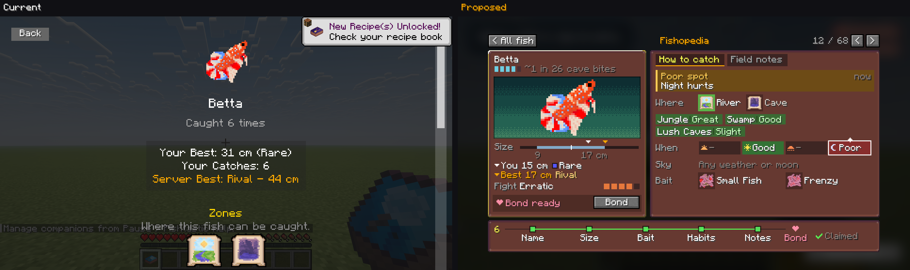

## 2. Method and evidence

| Source | What it gave | Where |
|---|---|---|
| New self-test scene `encyclopedia` (Fabric, 1920×1080, GUI scale 4/3/2) | 33 captures of 5 fixtures across states, plus page-height/scroll metrics read from the live `UIScreen` | `current/*.png`, `current/metrics.txt` |
| Code reading | Gating, ordering, scaling, pip logic, entry points | `FishEncyclopediaScreen.java`, `EncyclopediaTiers.java`, `QuestLogScreen.java` |
| Data survey of all 68 `fish_profile`s, lore, group tags, temperaments, baits | Content distribution and worst cases | survey numbers quoted inline |
| Vanilla `Window.calculateScale` | The smallest logical screen players actually get | §3 F1 |
| Pixel-faithful mockup renderer | Layout drawn in logical GUI px with vanilla's glyph atlas and widths; **fails on any text overflow or label collision** | `mockups/render_mockups.py` |
| All-species fit check | Every species, both tabs, worst-case strings (16-char player name, 3-digit sizes) | `mockups/validate_all_species.py` → **PASS** |

**Limits.** No players were observed and there is no telemetry. Statements about *what players want* are
labelled hypotheses (§4), each with the evidence behind it and a cheap way to test it. Statements about
*what the screen does* are measured.

Fixtures: **betta** (complete, 5 conditions, 2 zones, has a penalty), **glass squid** (complete, all 5 rewards
unclaimed, moon conditions), **bluegill** (abundant, 3 catches, mid-progress), **arctic char** (1 catch),
**Portuguese man o' war** (never caught).

## 3. Audit of the current page

| # | Finding | Evidence | Severity |
|---|---|---|---|
| F1 | **The page is ~2 screens tall at every GUI scale; a smaller GUI scale doesn't help.** `page.scaleToWidth(width × 0.6)` magnifies the column to 60% of screen width, so height scales with the screen. | Page height ÷ screen height, betta: 541/270 (scale 4), 726/360 (3), 1094/540 (2) ≈ **2.0×**. Worst is arctic char at 624/270 = **2.3×**. Auto scale puts 720p, 1440p and 4K at **426×240**, smaller than the 480×270 measured here. | High |
| F2 | **The first screen is identity and records; the catch guide is below the fold.** | `s4_*_top.png`: at 1080p Auto, the Zones icons fall onto the hotbar line. Spawn conditions, types and lore need 312–420 px of scroll. | High |
| F3 | **Fractional, per-fish text size, and two scales on one screen.** | The same "Your Best…" line is 560 px wide on betta and 725 px on arctic char (**1.29×**) at the same GUI scale. At scale 2 the page is ~2.4× while the Back button stays 1×. Glyph strokes come out uneven. | Medium |
| F4 | **The last element can't be reached.** At max scroll the "Choose fish" / bond line is cut off at the screen edge. | `s4_betta_bottom.png`, `s3_betta_bottom.png`, `s4_arctic_char_bottom.png` | Bug |
| F5 | **A green light next to a penalty.** Pips mean "this condition holds now", but colour reads as "good". At night, betta shows a green pip beside *Night (x0.5)*. | **15 of 68 species** (19 of 139 conditions) have a multiplier below 1. | High (misleads) |
| F6 | **Raw tag paths and unexplained multipliers.** | "Is Jungle", "Is Lush Caves", "Swamp, mangrove Swamp". "(x1.5)" has no stated meaning; "Base Weight: 4" is a designer number with no reference pool. | Medium |
| F7 | **"Types" names a group, not an action.** | Groups map to baits only indirectly: Big→**Trophy** Bait, Calm→Calm Bait, Exotic→Blazed Grub. **Steady** (10 species) has no bait at all. The empty-state text says "No bait affinities", so the code already treats this section as a bait section. | Medium |
| F8 | **Page order ≠ unlock order.** The page lists Stats, Types, Spawn, Lore. | COMMON and ABUNDANT tiers unlock Spawn at 4/6 *before* Types at 8/12, so the "next thing" is not the next section down. | Low–Med |
| F9 | **Locked sections are taller than unlocked ones.** Each lock is "???" + progress bar + sentence. | The arctic char page (1 catch) is *taller* than the complete betta page (624 vs 541). | Medium |
| F10 | **Claiming is scattered.** Up to 5 claim buttons per fish, 68 × 5 = **340** claim clicks across the book. | On glass squid only 1 of 5 is above the fold (`s4_glass_squid_top.png`). | Medium |
| F11 | **An uncaught fish's art is revealed.** The disc shows a black silhouette, but the info page shows the full-colour sprite at 3× next to "???". | `s4_disc.png` vs `s4_portuguese_man_o_war_top.png` | Low–Med (spoils discovery) |
| F12 | **Duplicate and ungrammatical text.** | "Caught 6 times" and "Your Catches: 6" on one page; "Caught 1 times". | Low |
| F13 | **Useful data missing, unhelpful data shown.** Temperament, i.e. how the fish *fights* in the minigame, exists for every species (10 kinds) and isn't shown. Base weight is shown. | `temperament/*.json`, `buildStatsContent` | Medium (opportunity) |
| F14 | **The HUD shows through.** Hotbar, hearts and the chat line render behind the content. | Every `s4_*` capture | Low |
| F15 | **No browsing.** Each fish needs Back → disc → click, with travel animations both ways. | Code: `goBackToDisc` / `onFishSelected` | Medium |
| F16 | **"Rare" means two different things.** Species rarity tiers and catch-quality tiers both use the word. | `EncyclopediaTiers.Tier.RARE` vs `FishQuality.Quality.RARE` | Affects any design |

## 4. Player jobs (hypotheses)

| # | Hypothesis | Evidence for it | Cheap validation |
|---|---|---|---|
| H1 | **"How do I catch this?" is the main reason to open a page**, often for a fish not caught yet. | The Quest Log checklist deep-links to a species page "whether discovered or still a silhouette" (`QuestLogScreen` ~L890). Zones were deliberately left ungated because "the player needs this before their first catch". The live per-tick pips only make sense for someone deciding where to fish. | Log page opens by entry point (disc / quest link) and caught/uncaught, for one playtest week. |
| H2 | **Most pages are seen complete.** Polish the complete state first and keep locked states compact. | 44 of 68 species are Rare or Very rare, so they complete in **3–6 catches** (`encyclopedia-tier-review.md`). | Same log, recording progress state. |
| H3 | **The reward loop needs one obvious action, not five.** | F10. The Quest Log already uses a single green Claim per row. | Count how many claimable tokens are left unclaimed after a session. |
| H4 | **Players compare their records with the server's.** | The server best was given its own gold line. A leaderboard screen exists. | Owner/players' call; low risk either way. |
| H5 | **Lore is read once.** It shouldn't hold permanent prime space. | Lore averages 198 characters and is static text. | Tab-open rate on Field notes. |

## 5. Design principles

1. **One screen, no scroll at 426×240.** Fixed design canvas **416×232**, drawn at integer scale `k = floor(min(W/416, H/232))`. Never fractional. More screen means crisper, not taller.
2. **Answer the main job first** (H1): a live verdict at the top of the right page.
3. **Encode effect and "now" separately.** Fill colour = effect on odds (green boost, red penalty, dark neutral). White outline + pin = what's true right now. This fixes F5.
4. **Show actions, not categories.** Bait items with item names instead of group tags. Biome names instead of tag paths.
5. **One progress model.** A single track in real unlock order, one claim button, and bond as the visible end of the track.
6. **Locked content takes no more space than unlocked content.** A locked row is one row.
7. **Reuse the mod's visual language.** The Quest Log's mauve 9-slice cards, gold/green variants and coin token. Vanilla buttons for navigation.

## 6. Proposed design: field-guide spread

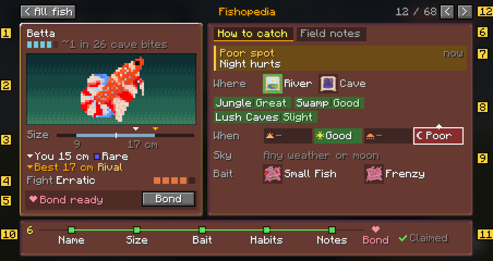

| # | Element | Behaviour, and which finding/hypothesis it addresses |
|---|---|---|
| 1 | **Name + rarity line** | 5 rarity gems + "~1 in 26 cave bites", both kept (D5). This uses the existing `EncyclopediaTiers.Rarity` best-pool share instead of base weight (F6). The species line never uses tier *words*, so on this page "Rare" only ever means catch quality (F16, D7). The gems are cyan so they can't be mistaken for Epic's purple. Uncaught: "???" / "Not yet caught". |
| 2 | **Specimen plate** | 64 px art on a water plate (4× item scale, 2× texture detail). **Silhouette until caught** (F11, D4). The disc→page travel animation lands here. Gold page border = entry complete. The plate is a **dithered, zone-themed background with animated bubbles**; see [bubbles/PLAN.md](bubbles/PLAN.md). |
| 3 | **Size ruler + records** | One bar replaces the Stats and Records blocks. The typical range (mean ± 2σ) is shaded, with a white marker for you and a gold one for the server best. Below it: "You 15 cm ■ Rare" and "Best 17 cm Rival". Catch quality keeps its existing names (D7) and is drawn as a pip in its chat colour + white text, because vanilla blue on the mauve panel is too low-contrast. Long player names are truncated, with the full name in a tooltip (F12, H4). |
| 4 | **Fight** | Temperament name + 5-step difficulty meter from `difficulty_min/max` (F13, D1). It unlocks with **Size**, which is 1 catch for 44 of 68 species, so the track keeps five milestones. |
| 5 | **Bond strip** | "Bond ready" + Bond button, or "Bond when complete". Always visible, no longer clipped (F4). |
| 6 | **Tabs** | *How to catch* (default) / *Field notes* (lore, padlock until unlocked) (H5). |
| 7 | **Live verdict, in plain words (D2)** | Headline **Great / Good / Fair / Poor spot**, then what's helping or hurting right now: "Jungle, Day help", "Night hurts", "Lush Caves, Full moon help; Night hurts". Red **Can't bite here – Fish in Ocean water** when the zone is wrong. Only uses unlocked information: before Habits it's zone-only, "Can bite here – Learn its habits to judge this spot" (H1, F5). |
| 8 | **Where / When / Sky (Weather, Moon)** | Zone icons (ungated) with the current zone outlined. Biome chips ("Jungle · Great"). Time-of-day and weather strips of 4 cells each, coloured by effect and labelled with the same words. 8-phase moon strip only when the moon matters, with the current phase outlined and a note ("Bright moons: slight help"). Axes that don't matter collapse into one line ("Any weather or moon"). The exact multiplier ("2x – twice as likely as usual") is in each tooltip, for players who want numbers (F5, F6). **Locked habits stay fully hidden (D3):** one generic locked row that never reveals which axes matter. |
| 9 | **Bait** | Real bait items + names, two per row (F7). Steady-only fish show "No special bait". |
| 10 | **Unlock track** | Name → Size → Bait → Habits → Notes → ♥ Bond, **sorted by this fish's thresholds** (F8). Only the next milestone shows progress ("Habits 3/4", yellow). |
| 11 | **Claim** | One green **Claim N** button with the total of all unclaimed sections (F10, D6). It reuses the existing per-section packet in a loop, or one new "claim all" packet. Shows "Claimed ✓" when done. A book-wide **Claim all** also sits on the disc (below). Both buttons show a **coin icon that grows with the amount** (see "Claim icons"). |
| 12 | **Browse** | `< 12 / 68 >` and ←/→ keys move between species in disc order. "< All fish" and Esc return to the disc (F15). |

The screen also draws its own dark backdrop, so the HUD no longer shows through (F14).

### Disc → portrait transition: one continuous fish (owner requirement)

The selected fish stays **one object** from the disc to the portrait, as it does today. The icon you
click is the icon that lands in the plate. Nothing is swapped, duplicated or cross-faded.

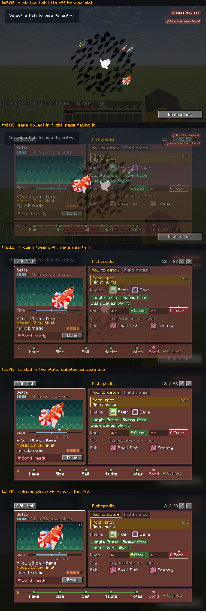

`mockups/transition_disc_to_portrait.gif` shows the motion. It's built from the real disc capture and the
real page render, with the betta painted out of its disc slot, because in game the icon itself leaves the slot.

| Moment | What happens |
|---|---|
| **Click** | The icon lifts off its slot at its hover scale (1.5×). The other disc icons shrink away at their rest positions, as today. |
| **Flight** | The same icon eases (the existing `setTargetPosition`/`setTargetScale` motion) to the portrait slot, growing to 4×. The page fades in around it over ~0.2 s. The plate is already bubbling (5 s warm start), so the fish flies *into* living water. |
| **Landing** | Once the motion is visually done (~0.45 s), **snap** to the exact slot and the integer 4× scale. The ease's tail otherwise leaves the sprite at fractional scales for over a second (measured 15.98× instead of 16× after 1.5 s at k=4), and fractional scale is what makes pixel art uneven. |
| **Welcome plume** | 0.8–1.6 s after opening, rising past the landed fish. |
| **Close** ("< All fish" / Esc) | The reverse flight from the plate back to the slot, then the other icons regrow, as today. It also snaps on arrival. |
| **Prev / next** (new) | There's no disc on screen to fly from, so the portrait handles it locally. The current fish slides ~24 px toward the pressed arrow and fades out (0.15 s). The next fish slides in from the opposite side at 4×. If the zone differs, the plate background cross-fades and its bubbles warm-start. The portrait is never empty. |
| **Close after browsing** | The fish **currently shown** flies to **its own** disc slot. Today's close (`sphere.reinstateAfterClose(closingIcon)`) assumes the icon returning is the one that left, so browsing needs the original icon reinstated silently and the shown fish's disc icon used for the flight. |
| **Uncaught** | Silhouette for the whole flight, matching the disc (D4). |

**Layering.**
- The flying icon lives in its own **icon layer** inside the canvas, between the plate and the transparent input layer (plate < icon layer < input layer + front bubbles < pause toggle). It can join mid-flight without index-inserting into the canvas.
- Reparenting into a scaled canvas preserves **position but not scale**, so the icon's local scale must be set to `globalScale / layer scale` immediately after `reparentTo`.
- Without that, the fish would visibly jump 2× or 4× bigger at GUI scale 2 or 1, and look fine at Auto, so it could easily ship unnoticed. Measured in the spike; see [gelatin-spike.md](gelatin-spike.md) rules 5–6.

**The portrait's pause toggle doesn't affect the flight.** The flight is navigation feedback (where did my fish go?), not ambience.

### Plain-word odds (D2)

The same vocabulary is used everywhere on the page, so the verdict and the rows never disagree. The bands
sit in natural gaps in the 124 primary multipliers shipped today, so no common value falls on a boundary.

| One condition's multiplier | Shipped count | Word |
|---|---|---|
| ≥ 1.75 (data: 1.8–2.2) | 41 | **Great** |
| 1.45–1.75 (data: 1.5–1.7) | 48 | **Good** |
| 1–1.45 (data: 1.2–1.4), plus every secondary bonus | 16 + 15 | **Slight** |
| 0.45–1 (data: 0.5–0.6) | 9 | **Poor** |
| < 0.45 (data: 0.1–0.4) | 10 | **Bad** |

| Combined odds right now | Verdict |
|---|---|
| ≥ 1.75 | **Great spot** (green) |
| 1.2–1.75 | **Good spot** (green) |
| 0.8–1.2 | **Fair spot** (blue-grey) |
| < 0.8 | **Poor spot** (amber) |
| wrong zone | **Can't bite here** (red) |

Checked for every species × zone × time × weather × biome (× moon phase where it matters): **2,752 verdict
lines, all fit**. The widest is "Lush Caves, Full moon help; Night hurts" (black ghost knifefish), at 196 of 222 px.

### Disc: book-wide claim (D6)

Shown only while something is claimable. It sits under the disc and totals every unclaimed section across all
species. The existing green reward pips show which fish it comes from.

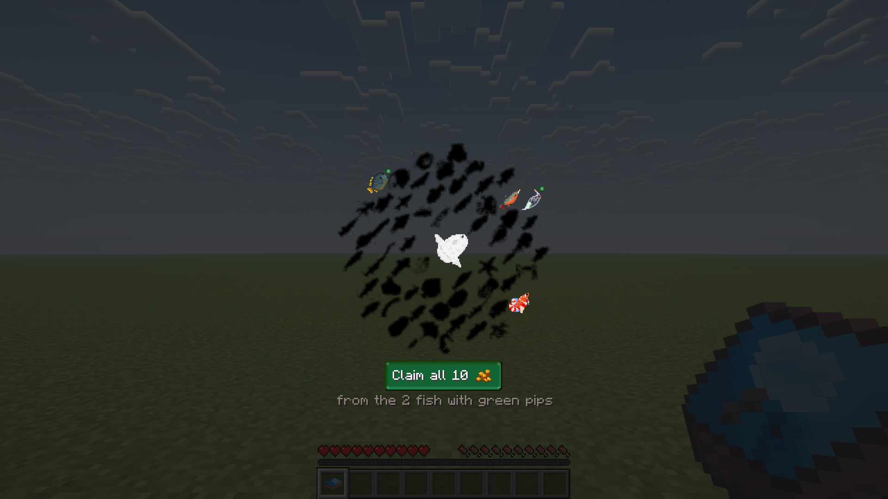

### Claim icons: coin ladder

Both claim buttons reuse the mod's coin and pile-of-coins art, picking the icon by amount. This follows the
same pattern as `QuestLogScreen.coinLadderIcon`, with thresholds of its own (quest rewards and shop prices
already have separate ladders). The encyclopedia needs its own because one fish pays at most
1+1+1+2+3 = **8** tokens. On the quest-reward ladder, where piles start at 25, every page would show a
single coin.

| Amount | Icon | Where it shows up |
|---|---|---|
| 1 | one coin | a single unlock (Name / Size / Bait) |
| 2 | two coins | Habits, or two small unlocks |
| 3–7 | small pile | part of a fish's rewards |
| 8–19 | medium pile | a **whole fish** (8), or a short disc backlog |
| 20+ | large pile (`pile_of_coins`) | disc backlog of 2.5+ fish |

The **three-coin stack is deliberately left out.** At 16 px it reads as *more* gold than the small pile (a
tall solid column vs three scattered coins), so including it would make a bigger reward look smaller. The
first render of this ladder had exactly that inversion ("Claim 4" looked richer than "Claim 8"). Each
button keeps its icon in a fixed 16 px slot, so the label doesn't move as the icon changes.

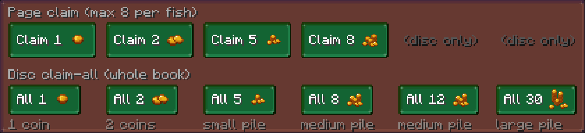

*Observation, not changed:* the Quest Log's reward ladder has the same inversion between 14–24 tokens
(three-coin stack) and 25+ (small pile).

### States

| Complete, penalty active (night) | Complete, boost active (jungle, day) |
|---|---|
| 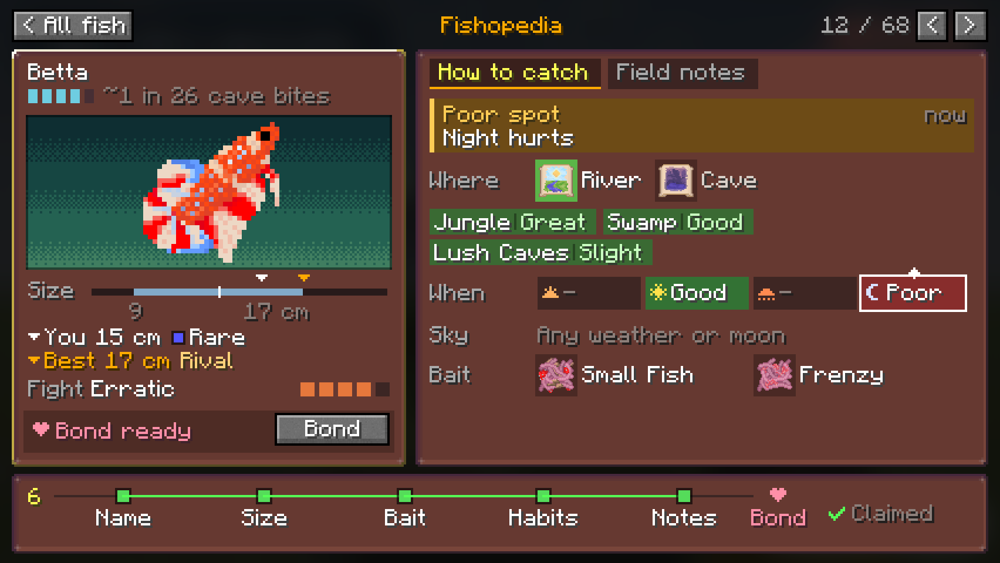 | 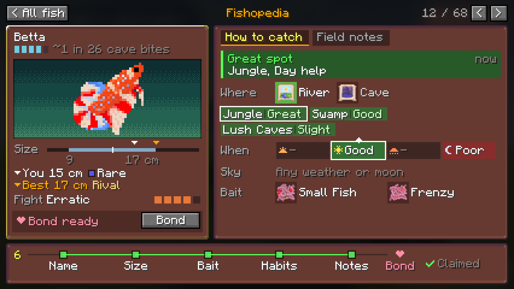 |
| **All rewards unclaimed, moon fish** | **Mid-progress (abundant species)** |
| 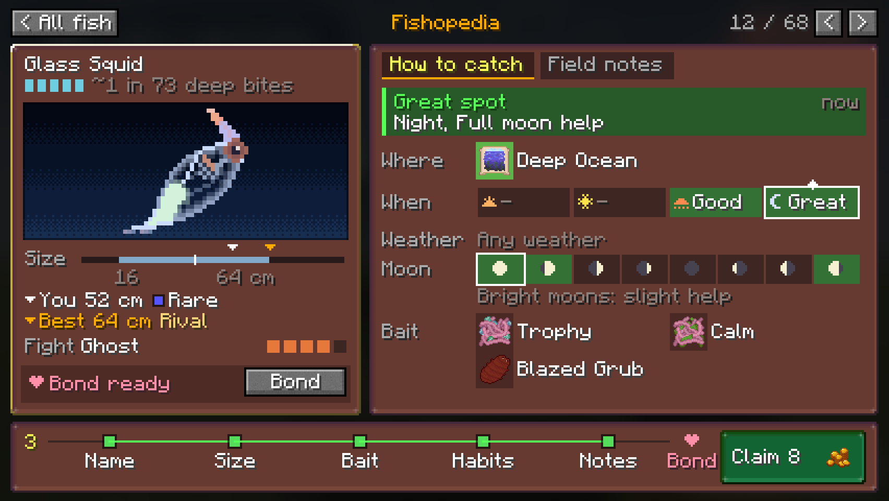 | 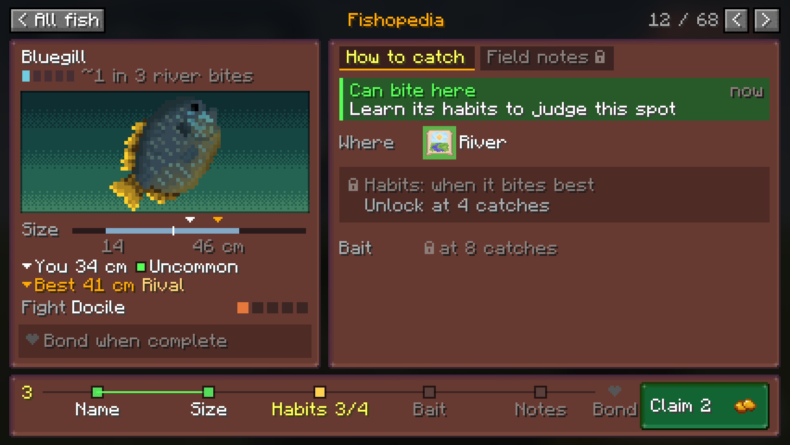 |
| **Never caught (quest-link entry): silhouette (D4), habits fully hidden (D3)** | **Field notes tab** |
| 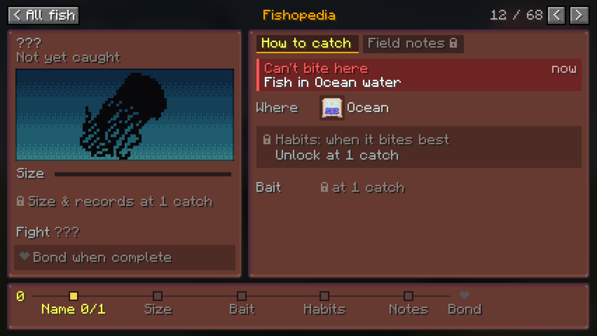 | 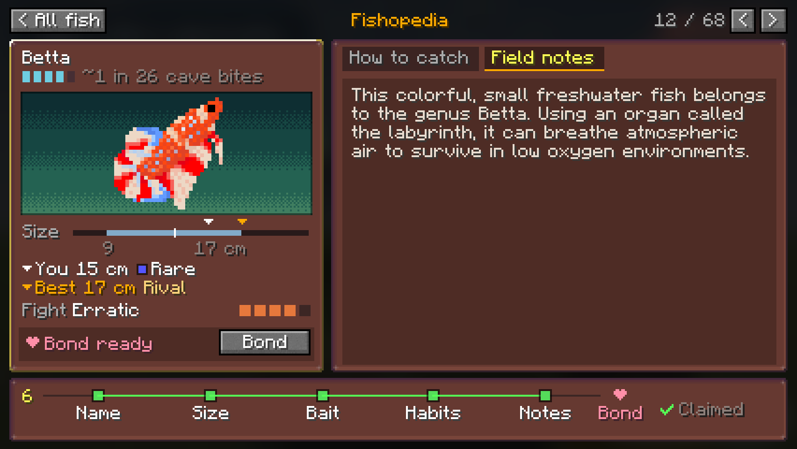 |

The uncaught case side by side with today's page:

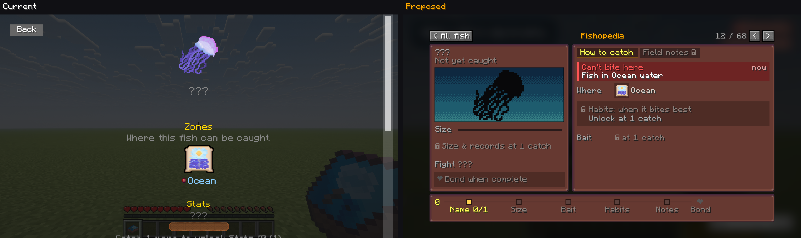

### Screen sizes

| Screen (logical) | Typical setup | Result |
|---|---|---|
| 426×240 | 720p / 1440p / 4K on Auto | canvas at 1×, 5 px margins (A1–A6) |
| 480×270 | 1080p on Auto | canvas at 1×, centred (A7) |
| 960×540 | 1080p, GUI scale 2 | **canvas at exactly 2×**, crisp (A8) |
| < 416×232 | 4:3 or small windows | compact single-column fallback (B1, sketch) |

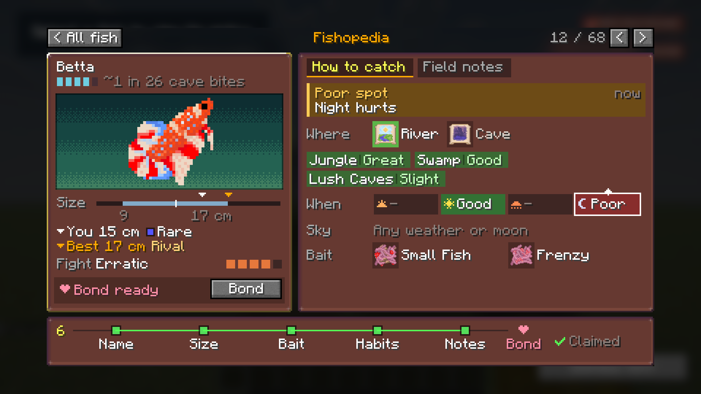

### Where each piece of content went

| Today | Proposal |
|---|---|
| Name + name claim button | Name (1); the claim joins the single Claim (11) |
| Caught N times / Your Catches | Count at the start of the track (10). The duplicate is gone. |
| Your Best / Server Best | Size ruler markers + 2 record lines (3) |
| Zones (ungated) | Where row, still ungated (8) |
| Stats: base weight | **Removed.** Replaced by the rarity line (1) |
| Stats: average size ± sd | Ruler range (3) |
| Types | Bait items (9) |
| Spawn conditions | Biome chips + When / Sky strips (8) + verdict (7) |
| Lore | Field notes tab (6) |
| Per-section locked placeholder + bar + sentence | One locked row + the track (10) |
| Companion status + Choose fish | Bond strip (5) + track end node |
| *(not shown)* temperament | Fight (4) |

## 7. Critical review

**Checked mechanically.** Every text element is measured against its box with vanilla glyph widths. Labels
are checked for collisions, and the right page for vertical overflow. Run against **all 68 species × both
tabs** at 426×240 with worst-case strings, the result is **PASS**. The longest lore (ornate bichir, American
paddlefish) needs 9 of the 14 available lines. Every possible verdict line is also checked (2,752; see §6).

**Defects my review caught and fixed before presenting:**
- Translucent fills rendered opaque (a renderer bug: PIL doesn't blend on RGBA).
- "Rare" used twice with different meanings (became F16).
- Right page overflowed by 11 px for betta, from indented biome chips.
- "Weather" label collided with its value.
- Bait group names alone were ambiguous because the bait icons look alike.
- Compact fallback clipped the Bait row and had a redundant Records tab.
- Footer labels collided ("Notes 3/30Bond"). The box checker had missed this, so I added a neighbour-collision check.
- A tab padlock overlapped the tab edge.
- The verdict omitted the moon as a cause.
- The uncaught page drew a caption over the silhouette.
- "No rewards" overflowed the footer.
- A 16-character player name overflowed the record line. Found only by the all-species worst-case run; now truncated, with a tooltip.
- *(revision 2)* The first plain-word verdict copy ("Helped by …; hurt by …") overflowed for one of 2,752 environments; reworded to "X, Y help; Z hurts".
- *(revision 2)* Chip label and word ran together ("JungleGreat"); added a gap and divider.
- *(revision 2)* The moon strip had no "now" outline, unlike time and weather; added.
- *(revision 3)* The first coin ladder put the three-coin stack below the small pile, but the stack looks bigger; removed that rung.
- *(revision 2)* Rarity gems in purple read as Epic quality; recoloured cyan. Rare-quality blue text was low-contrast on the mauve panel; it's now a colour pip + white text.

**Known weaknesses and risks (not fixed, need a decision or more work):**
1. **The verdict reflects the environment only.** `FishProfile.computeEnvironmentMultiplier` is available client-side, and the current pips already mirror the charm night override. Bait affinity and charm group bonuses aren't included. Plain words (D2) make this much less likely to mislead than numbers, but the tooltip should still say "based on where and when you're fishing".
1a. **The word bands follow today's data.** Future species will still land in a word, but the bands should be rechecked whenever many new species are added. The band constants belong next to the existing multiplier-cap guidance.
2. **"~1 in 26 cave bites" is approximate.** It ignores bait, conditions and vanilla fish. Kept by decision (D5); its tooltip should say "base odds in its best water".
3. **The bait textures are hard to tell apart.** Small Fish, Frenzy, Trophy and Calm bait are all pink worm clumps at 16 px, so the names carry the meaning. Art could fix this, but that's out of scope.
4. **7 px moon-phase icons** are readable but small. Tooltips with phase names are needed.
5. **The right page is sparse in early states**, and the Field notes tab is mostly empty for short lore. This is honest, and the teaser that would have filled it was declined (D3).
6. **New art needed:** time and weather glyphs, moon phases, padlock, heart, pin. The mockups use placeholder pixel drawings.
7. **The compact fallback (B1) remains visually provisional.** It is now implemented as a 300x228 single-column card with a visible back button, live verdict, tabs, claim/bond action, and progress footer; the 320x240 self-test exercises all five fixtures on both loaders. It still needs a final playtest polish pass.
8. **H1–H5 are unvalidated.** The layout gives "How to catch" the default tab on that bet. If H1 is wrong, it would be cheap to flip the default tab.
9. ~~gelatin-ui support for an integer-scaled canvas and tooltips~~ **Checked:** feasible as-is, see [gelatin-spike.md](gelatin-spike.md).

## 8. Decisions (owner, 2026-10-20)

| # | Question | Decision | Where it shows |
|---|---|---|---|
| D1 | Show temperament? | **Yes.** Unlocks with Size | Fight row (4) |
| D2 | Odds wording | **Plain words.** Applied everywhere, exact multiplier in tooltips | Verdict (7), chips/strips (8), §6 tables |
| D3 | Locked habits | **Fully hidden** | A4, A5 |
| D4 | Uncaught art | **Silhouette** | A5 |
| D5 | Rarity line | **Keep both** (gems + "~1 in N bites") | (1) |
| D6 | Claiming | **One button per page + one on the disc** | (11), D1 mockup |
| D7 | "Rare" collision | **Don't rename catch quality.** The species line avoids tier words instead, and the gems are recoloured | (1), (3) |

## 9. Files

- `current/`: 33 captures from the `encyclopedia` self-test scene + `metrics.txt`
- `mockups/*.png`: proposal renders (A = field-guide spread, B = compact fallback, D1 = disc claim-all, E1 = claim coin ladder, `compare_*` = side by side)
- `mockups/render_mockups.py`: renderer + fit checker. `python -I docs/encyclopedia-redesign/mockups/render_mockups.py`
- `mockups/validate_all_species.py`: all-species fit check
- `gelatin-spike.md` + `gelatin-spike/`: **gelatin-ui feasibility spike: feasible as-is, 32/32 checks, four implementation rules**
- `_assets/`: vanilla font and button sprites extracted from the 26.1.2 client jar (mockup use only)
- Self-test: `encyclopedia` scene in `RenderSelfTest.java` (opt-in; write `encyclopedia` into `<run dir>/fishtastic_render_selftest`, and delete the marker afterwards)
