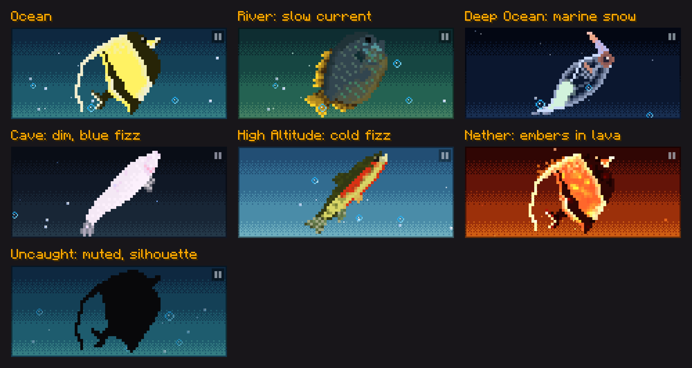
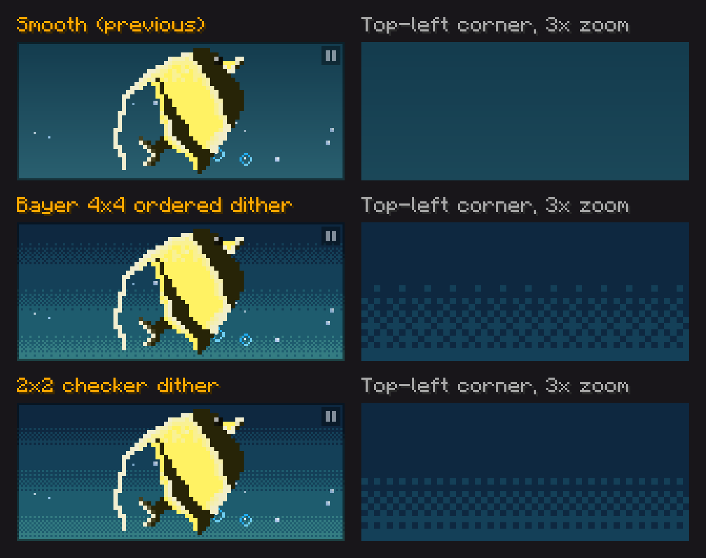
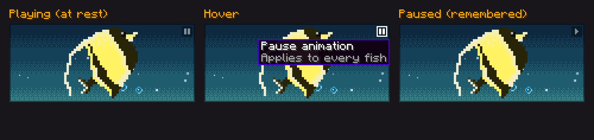

# Portrait ambient bubbles: plan

> Status: **plan + motion prototype (2026-10-20). Look approved; owner decisions B1–B7 applied (§7). Ready to build once the info page exists.** No mod code. Part of the Fishopedia
> info-page redesign ([../README.md](../README.md), element 2, "specimen plate").

**Watch first:** `bubbles_ocean.gif`, `bubbles_river.gif`, `bubbles_deep_ocean.gif`, `bubbles_cave.gif`,
`bubbles_high_altitude.gif`, `bubbles_nether.gif`, `bubbles_uncaught_muted.gif` (6 s each, 1080p Auto scale).
They come from `prototype_bubbles.py`, which runs the same rules the in-game element would, in logical
pixels, snapped to the pixel grid.

Plate backgrounds are **dithered pixel-art ramps** (§2a). The six candidate textures are in `plates/`.

## 1. Intent

Make the portrait feel like a living specimen in water without competing with the page's main job. The
player reads the right-hand page to decide where to fish ([../README.md](../README.md) H1). Moving things
in peripheral vision draw the eye, so the bubbles must stay background:

- **Reuse the tank's bubble vocabulary.** Sizes, dissolve-vs-pop and wobble come from
  `TankMicroBubbleParticle`, so the portrait reads as the same water players see in their tanks.
- **Make variety come from rhythm, not volume.** Steady fizz, occasional rings, a plume every few seconds, and a welcome plume on arrival.
- **Calm by construction.** Slow rise speeds, no flashing, a hard cap of 32 bubbles, and most of them behind the fish.

## 2. What varies

| Axis | Variety |
|---|---|
| **Kind** | **Micro** (1 px, white/blue): fizz from the lower half, fades out mid-water. **Small** (2 px `small_bubble`): rises from the floor with a gentle wobble, shrinks to 1 px and dissolves. **Medium** (`medium_bubble`, drawn 4–7 px): slow, wide wobble, **pops at the surface** with vanilla's 5-frame `bubble_pop`. |
| **Motion** | Each bubble gets its own rise speed, wobble size and frequency, and phase, so no two columns march in step. |
| **Rhythm** | Steady emission, plus **plumes**: a short column of 4–7 small/medium bubbles from one spot, every 5–8 s. A **welcome plume** 0.8–1.6 s after the page opens means every visit shows the full range once. |
| **Depth** | ~20% of medium bubbles pass **in front of** the fish; everything else is behind it. |
| **Place** | Theme from the fish's **first listed zone** (stable per species; the page shouldn't change look as you walk). See §3. |
| **State** | Uncaught: same theme, bubbles at **50% opacity** behind the silhouette. Caught and complete: no extra effect (the gold page border already marks completion). |

## 2a. Dithered backgrounds

Each theme's background is a **hand-picked 4-colour ramp**, dark at the top and light at the bottom. Each
ramp is *hue-shifted* as pixel artists do: lighter steps slide toward cyan/green (water) or yellow (lava)
instead of just getting brighter. The ramp is drawn as solid bands, with an **ordered-dither pattern only
in the transition zone** between each pair: 60% of each band dithers, and the band middles stay solid.

- **Recommended: Bayer 4×4.** It steps through four densities (scattered dots → checker → dense), so the transitions stay soft while still clearly patterned.
- **Alternative: 2×2 checker.** Two stages, so it reads chunkier and more retro.
- Linear interpolation was tried first and rejected: 5 automatic steps ended up 6–9 levels apart, so the dither was invisible.
- **Bubbles stay readable over the pattern** because a bubble is much brighter than one ramp step. That gap should be kept if a ramp is retuned. A ramp step close to micro-bubble white would make the scattered dither dots look like fizz.

**In game this is a static texture per theme:** `textures/gui/encyclopedia/plate_<zone>.png`, 156×66, one
blit, no per-pixel drawing. The plates in `plates/` are generated by `prototype_bubbles.py`
(`plate_background`). Ship them as generated, or hand-touch them in an image editor afterwards. They're
plain PNGs, and only the outside edge and colour count are constraints.

## 3. Zone themes

| Zone (species) | Plate ramp (top → bottom) | Bubbles | Special |
|---|---|---|---|
| Ocean | navy → teal → sea-green | baseline | none |
| River | dark green-teal → moss | baseline | **current**: everything drifts right at 3.5 px/s |
| Deep Ocean | near-black → navy | 40% rate, 70% speed | **marine snow**: pale specks drifting *down* |
| Cave | ink → dim slate | 60% rate | blue-tinted fizz |
| High Altitude | cold blue → pale ice | baseline | 2.2× micro fizz (aerated water), slight drift |
| Nether | dark red → lava orange | none | **embers** (flickering 1 px sparks, yellow → red) + slow molten globules |

Measured in the prototype (6 s after a 5 s warm start):

| Theme | Avg visible | Peak |
|---|---|---|
| Ocean | 14.8 | 17 |
| River | 14.4 | 17 |
| Deep Ocean | 14.2 | 17 |
| Cave | 8.2 | 11 |
| High Altitude | 16.7 | 20 |
| Nether | 9.5 | 12 |
| Uncaught | 14.9 | 18 |

## 4. Parameters (logical px, seconds)

| Kind | Spawn | Rise | Life | Wobble | Ends |
|---|---|---|---|---|---|
| Micro | 2.4/s, lower half | 10–18 | 0.9–2.2 | 0.2–0.6 px @ 1.5–3 Hz | fades over its last 0.4 s |
| Small | 1.2/s, floor | 7–12 | 3–6 | 0.6–1.3 px @ 1–1.8 Hz | shrinks to 1 px for 0.6 s, then gone |
| Medium | 0.35/s, below floor | 5–8 | until surface | 1–2 px @ 0.5–0.9 Hz | `bubble_pop_0..4` at y=3, 0.25 s |
| Plume | every 5–8 s (first at 0.8–1.6 s) | n/a | n/a | n/a | 4–7 bubbles, 30% medium, 3.5 px apart |
| Snow (deep) | 0.9/s, top | falls 2–4.5 | until floor | 0.5–1.5 px @ 0.2–0.5 Hz | leaves the plate |
| Ember (nether) | 3/s, floor | 9–17 | 1.5–3.5 | 0.4–1.2 px | colour ages yellow → orange → red, fades |

Theme multipliers scale spawn rates and rise speeds. Cap: 32 alive; spawns past the cap are skipped.

## 4a. Pause toggle and player-triggered extras

### Pause toggle (B5)

- **A 9×9 button in the plate's top-right corner**, which is clear of the fish art on every species (the art sits in the middle 64 px).
- **It shows the action**, like a media control: a pause bars icon while playing, a play triangle while paused. At rest it's a faint translucent square with a 60%-opacity icon, so it doesn't compete with the specimen. On hover it gets full contrast, a white outline, and a tooltip: **"Pause animation" / "Play animation"**, with a grey second line **"Applies to every fish"**. The setting is global, so the tooltip says so; otherwise pausing one portrait and finding all of them paused would surprise you.
- **The preference is remembered globally**, as a client setting rather than per world or server. It's a new key in `fishtastic-client.properties`, `encyclopediaPortraitAnimations=true` (default on). The precedent is `shapeGalleryOpen`, a GUI-button toggle that calls a `FishtasticClientConfig` setter to update the cache and rewrite the file immediately.
- **Paused** freezes the current frame as a still (the plate still looks like water) and disables both extras. Unpausing resumes from that frame.

### Click the portrait: plume (B4)

`interact_click_plume.gif`, `interact_click_nether.gif`

- A click anywhere on the plate releases a plume **from the cursor**: 5 small + 2 medium + 6 micro bubbles, rising 30% faster than ambient.
- Click **on the fish** and the plume's bubbles go in **front** of it, so they seem to come off the fish.
- **Nether:** 18 embers that start as **hot 2 px white-yellow sparks** and cool to 1 px as they spray up. The first version used ordinary 1 px embers, and the click barely showed against the lava.
- Rate-limited to one plume per 0.35 s. Player-triggered bubbles may raise the cap from 32 to **56**; the prototype peaks at 40 (ocean) and 45 (nether) with three quick clicks.
- No cursor change or hint. It's a discover-it-yourself delight, and clicking does nothing else on the plate, so there's nothing to confuse it with.
- **Sound (B7):** each accepted click plays one pop. The player chose to click, so the sound is feedback, not ambient noise.
  - Water themes: **`SoundEvents.BUBBLE_POP`** (`ui.hud.bubble_pop`), vanilla's own HUD air-bubble pop. It's already a UI sound and players know it from swimming. Volume 0.35, pitch randomised 0.9–1.3 so repeated clicks don't sound stamped.
  - Nether: **`SoundEvents.LAVA_POP`** (`block.lava.pop`). Volume 0.2 (it's louder at source), pitch 0.8–1.1.
  - Played with `SimpleSoundInstance.forUI(...)`, so it goes to the **Interface** volume slider (`SoundSource.UI`, no attenuation). Players can turn it down with a vanilla control; no new mod setting.
  - It follows the plume exactly: no plume (while paused, or inside the 0.35 s cooldown), no sound. Spam-clicking therefore can't produce more than ~3 pops a second.
  - The claim burst adds **no** sound of its own; it rides on the Claim button's feedback.

### Claim burst (B4)

`interact_claim_burst.gif`, `interact_claim_burst_nether.gif`

- Pressing the page's **Claim** button sends a rush up the whole plate: 16 small/medium bubbles spread across the floor rising 1.7× faster, plus 14 micro fizz. Nether gets 28 hot sparks. This plays alongside the existing coin flourish from the button.
- **Skipped when `reducedCelebrationEffects=true`** (the existing accessibility option that already tones down catch celebrations) and when animations are paused.
- The disc's Claim-all has no portrait, so it keeps only the coin flourish.

## 5. Implementation plan

**Use a small fishtastic-side element, not gelatin-ui's `ParticleSystem`.** Its particles only have velocity +
gravity + lerped scale/alpha/colour. There's no per-particle behaviour hook (wobble, pop at the surface,
shrink-to-1px dissolve), no clipping to the element's bounds, and positions are unsnapped floats (1–2 px
bubbles would shimmer). Adding those to gelatin would mean a library release, which has its own publish
friction. The element can be moved upstream later if another screen wants it.

1. **`PortraitBubbles` model + element** (`client/encyclopedia/`).
   - A plain bubble list stepped by real frame time. dt is clamped to ≤ 0.1 s, so a lag spike doesn't release a burst.
   - On open, the model pre-simulates 5 s so the plate is already alive when the icon lands, then schedules the welcome plume.
   - The RNG is seeded from the species id, so captures are reproducible.
2. **Two draw layers around the travelling icon.** The fish icon is the `SilhouetteItemButton` that flies in from the disc, so the plate adds a *back* element before it and a *front* element after it, sharing one model. Both draw inside a scissor rect for the plate, with positions rounded to the logical pixel grid.
3. **Sprites (all existing):**
   - `fishtastic:textures/particle/{small_bubble,medium_bubble}.png`
   - micro bubbles drawn as 1 px fills
   - `minecraft:textures/particle/bubble_pop_0..4.png`
   - embers and snow drawn as fills.
4. **Themes** as a small record per zone (plate texture, rate/rise multipliers, drift, special emitter), picked from `FishProfile.zones().get(0)`. The six plate PNGs go to `assets/fishtastic/textures/gui/encyclopedia/`.
5. **States:** uncaught = 50% opacity. Stop updating while the screen isn't shown; the warm start covers re-entry.
6. **Pause toggle + global pref** (§4a). Add `encyclopediaPortraitAnimations` to `FishtasticClientConfig` (getter, setter that persists, and a commented default line in `DEFAULT_FILE_CONTENTS`), plus the corner button.
6b. **Extras** (§4a): plate click → `click(x, y)`, which returns whether a plume fired; only then play the theme's pop via `Minecraft.getInstance().getSoundManager().play(SimpleSoundInstance.forUI(...))`. The page's Claim handler → `claimBurst()`. Both are no-ops while paused, and the burst is also skipped under `reducedCelebrationEffects`.
7. **Self-test:** extend the `encyclopedia` scene. Freeze to fixed steps and capture each theme at t = 0 / 1 / 2 s. Check that no pixel outside the plate changes between frames (clip check), and log alive counts against the cap.

| Step | Size | Can be checked by |
|---|---|---|
| 1–2 element, layers, clip, ocean theme | small | self-test capture + clip check |
| 3–4 all kinds, plumes, 6 themes | small | per-theme captures vs these GIFs |
| 5–6 states, toggle + global pref | tiny | capture paused; toggle, reopen, still paused |
| 6b click plume, claim burst | tiny | scripted self-test click/claim captures vs these GIFs |
| 7 self-test + owner look | small | owner in-game look (motion can't be judged from stills) |

This depends on the info-page redesign itself, because the plate only exists in the new layout. It can
be built as the first slice of that work.

## 6. Risks

- **Distraction.** The numbers above are a first guess tuned by eye in the prototype. The real test is your look in game with the "How to catch" page in view. The density knobs are three rates, so tuning is cheap.
- **Bursts above the cap.** Player-triggered extras may reach 56 bubbles; still a trivial number of blits, but the self-test should log the peak.
- **The plate click is undiscoverable by design.** Fine for a delight; nothing important depends on it.
- **14 species have two zones;** first-listed picks the theme. Betta (river + cave) would get the river current, not the dim cave.
- **Animated fish textures** (e.g. molten moorish idol) are animated by the item renderer as usual; the prototype only draws their first frame.
- **Medium bubbles look much the same at 4–7 px.** Size variety reads mostly through the micro/small/medium split, not within the medium kind.

## 7. Decisions (owner, 2026-10-20)

| # | Question | Decision |
|---|---|---|
| B1 | Zone themes | **Yes** (implied by B2) |
| B2 | Nether | **Lava with embers** |
| B3 | Bubbles in front of the fish | **Yes**, ~20% of medium bubbles plus click plumes on the fish |
| B4 | Extras | **Both**: click-to-plume and the claim burst |
| B5 | Animation setting | **On by default**, a small toggle in the portrait corner, **remembered globally** |
| B6 | Dither | **Bayer 4×4** |
| B7 | Click sound | **Yes**: it's an active player choice. `ui.hud.bubble_pop` (water) / `block.lava.pop` (Nether), Interface volume, rate-limited with the plume |

No open questions remain for the portrait.
