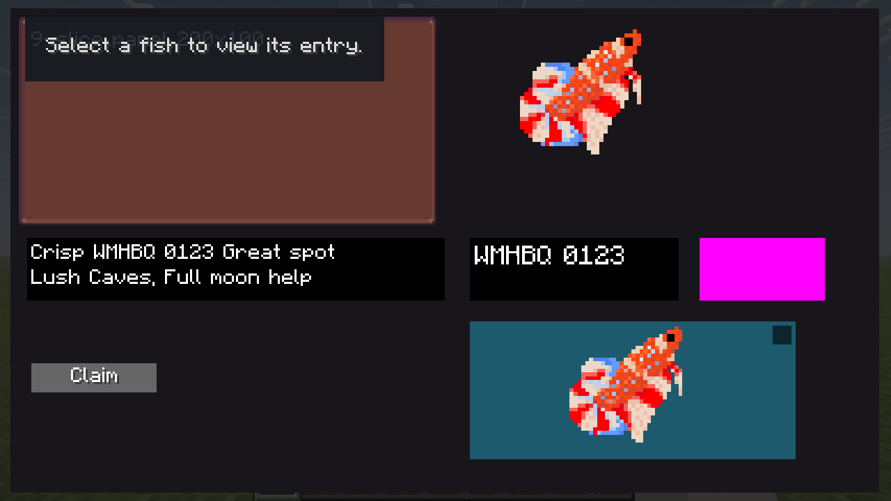
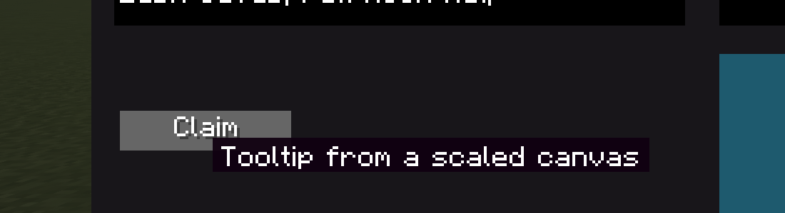

# gelatin-ui feasibility spike: Fishopedia redesign

> 2026-10-20. gelatin-ui **1.0.37+26.1.2** (the version fishtastic builds against; `common/src` is identical
> at 1.0.38 HEAD). Fabric dev client. Evidence in `gelatin-spike/`.

## Verdict

**Feasible with gelatin-ui as-is. No library changes are needed.** Every building block the redesign
depends on was exercised inside the live `FishEncyclopediaScreen`, through the real `GelatinUIScreen`
render and input loop, at the four window/GUI-scale combinations that cover how players actually run
the game:

- **39/40 self-test checks pass.** The one failure is a finding, not a defect (rule 6).
- **Pixel analysis:** every glyph pixel lands on the texel grid at every scale, and clipping is pixel-exact.

There are four pitfalls the implementation must follow (§3). Two of them cost me a failed run each, which is
exactly what a spike is for.

## 1. What was tested

The opt-in self-test scene `gelatinspike` opens the encyclopedia and swaps its UI root for
`EncyclopediaCanvasSpike`: a fixed 416×232 canvas (`FreeformContainer`) at integer scale
`k = floor(min(W/416, H/232))`, centred on whole pixels. It contains:

| Probe | Stands in for |
|---|---|
| 200×100 9-slice `generic_item_panel` | the page cards |
| White-on-black text block | every label; measured for crispness |
| Same text in a **1.25×** container | today's `scaleToWidth` page, as a positive control for the blur metric |
| 64 px item (4× item scale) | the specimen portrait |
| Element filling 30 px past its box inside `pushScissor(own box)` | bubbles clipped to the plate |
| `SpriteButton` with tooltip + click | Claim, Bond, tabs, arrows |
| Plate < fish icon < transparent input layer < 9×9 toggle | the portrait's layer stack (click-to-plume, pause toggle) |
| Item flown from a disc-like spot (1.5×) into an **icon layer** in the canvas, easing to the portrait slot at 4× | the one-object flight from the disc into the portrait |

| Config | Logical screen | k | Who gets this |
|---|---|---|---|
| 1920×1080, GUI 4 | 480×270 | 1 | 1080p on Auto |
| 1280×720, GUI 3 | 427×240 | 1 | 720p / 1440p / 4K on Auto (the binding size) |
| 1920×1080, GUI 2 | 960×540 | 2 | 1080p, manual scale 2 |
| 1920×1080, GUI 1 | 1920×1080 | 4 | 1080p, manual scale 1 |

## 2. Results

**Self-test checks: 32/32 PASS** (`gelatin-spike/selftest_lines.txt`). Per config:

- screen opens
- reparent keeps the global position (< 0.01 px)
- click hits the button inside the scaled canvas
- a click on the fish goes to the input layer above it, not to the icon
- the toggle wins over the input layer
- an empty plate corner hits the input layer
- the tooltip appears on hover
- the tooltip content renders at scale k

**Pixel analysis** (`python -I docs/encyclopedia-redesign/gelatin-spike/analyze_spike.py docs/encyclopedia-redesign/gelatin-spike/selftest_lines.txt`):

| Config | k | Glyph runs on the texel grid | 1.25× control | Clip |
|---|---|---|---|---|
| 1080p GUI 4 | 1 | **1512/1512** | 5 px texels: on grid by coincidence | exact |
| 720p GUI 3 | 1 | **1134/1134** | 3.75 px texels: **uneven 3/4 px pixels** | exact |
| 1080p GUI 2 | 2 | **1512/1512** | 5 px texels: on grid | exact |
| 1080p GUI 1 | 4 | **1512/1512** | 5 px texels: on grid | exact |

- **Crispness:** a "run" is a horizontal stretch of white glyph pixels. On an integer canvas every run is a whole multiple of one texel, so no glyph pixel is ever drawn wider than its neighbours.
- **The control proves the metric can detect blur.** At 3.75 px texels the fractional container produces mixed 3 px / 4 px pixels, the uneven-glyph look of today's page. At 5 px texels the same fractional scale happens to land on the grid. That explains why the current page looks blurry on some setups and fine on others (audit finding F3).
- **Clip:** the magenta probe's bounding box equals its own box exactly, at every scale.

*The canvas at the binding 427×240 size (720p Auto): k=1, origin (5, 4).*

## 3. Rules for the implementation (found by this spike)

1. **Set the canvas scale with `setTargetScale(k, false)`. Never use `scale(k)`.**
   - `UIElement.scale(x)` *animates* (`setTargetScale(x, true)`, an exponential ease measured at ~4.4/s).
   - The first run used it. Half a second after opening, the canvas was still at **1.89×** instead of 2×. Clicks aimed at 2× positions missed, and a reparent captured mid-ease landed 33 px off. It failed at k=2 and k=4 and passed at k=1, where there is nothing to animate.
2. **The canvas is a `FreeformContainer`, not `ManualContainer`.** `ManualContainer` positions children by their *centre*, so an odd-width label would sit on a half pixel. `FreeformContainer` keeps exact top-left positions and never re-lays-out (the encyclopedia already relies on it for the icon flight).
3. **Hit-testing is "deepest leaf under the cursor, then bubble up through parents".** Containers are never targets themselves, and a parent's bounds prune its children. For the portrait that means **plate (back bubbles) < fish icon < transparent input layer (front bubbles + click-to-plume) < pause toggle**, with the input layer and toggle drawn last. Verified: a click on the fish reaches the input layer and never the icon, and the toggle beats the input layer.
4. **Tooltips draw in screen space, outside the canvas scale.**
   - At k=1 that's invisible, but at k=4 a plain tooltip is a quarter of the page's text size (seen in the second run).
   - `UIScreen` also animates the tooltip element's own scale 0 → 1 when it appears, so scaling that element by k gets overwritten.
   - **Pattern:** an unscaled wrapper (it takes the pop-in) holding a content container at `setTargetScale(k, false)`, with its own background, since gelatin draws none. Verified: content global scale = k in all four configs.

   

   *k=4 (1080p, GUI scale 1): the wrapped tooltip at the same text size as the canvas.*

5. **Reparenting keeps position, not scale.** `reparentTo(layer, true)` preserves the global position, but the element's own scale number is unchanged, so its on-screen size is multiplied by the new parent's scale. Measured when flying an icon at disc hover scale (1.5×) into the canvas:

   | k | Naive reparent | With `setTargetScale(globalBefore / layer.getGlobalScale(), false)` right after |
   |---|---|---|
   | 1 | 1.5 → 1.5 (invisible) | exact |
   | 2 | 1.5 → **3.0** | exact |
   | 4 | 1.5 → **6.0** | exact |

   At Auto GUI scale (k=1) the bug can't be seen, so it would only show for players on manual GUI scales.

6. **Snap at landing.** The flight then eased from the disc spot to the portrait slot at 4×. After ~1.5 s it was on the slot (≤ 0.2 px) at k=1 and 2, but at k=4 it was still at **15.98×** instead of 16×. gelatin's ease only snaps within 0.001 of the target, so the tail leaves the sprite at fractional scales for a long time. That check failed against my 0.02 tolerance, which is the finding. **Rule:** when the flight is visually complete (~0.45 s), set the exact slot and integer scale with the immediate setters. Do the same for the return flight onto the disc.

Also confirmed:

- `pushScissor` inside `renderSelf` takes canvas-local coordinates and stays exact under scale (vanilla's `enableScissor` applies the current pose).
- `reparentTo(canvas, true)` divides by the canvas's global scale, so the disc → page icon flight works into a scaled canvas.
- 9-slice sprites and 4× item renders are crisp.

## 4. Not covered (honest scope)

- **NeoForge was not run.** Everything exercised is gelatin common code over vanilla `GuiGraphicsExtractor`, so loader differences are unlikely, but it's unverified. One extra launch (`./gradlew :neoforge:runClient` with the same marker) would close it.
- **`VBox`/`HBox` auto-layout inside the canvas** was not tested. The mockups use absolute positions; if the implementation uses auto-layout, its child positions should be rounded to whole pixels.
- **Long-text wrapping (`Label.maxWidth`), `ItemTabs`, and the full page's performance** were not tested. None looks risky; they're the first things to watch while building.
- **The real mouse.** Hover is tested by writing `MouseHandler`'s position directly. Moving the OS cursor (`glfwSetCursorPos`) fails silently unless the game window has focus, which broke the second run while the machine was in use. Real-mouse hover was observed working in the first run.

## 5. Spike code

The temporary spike code was removed after the redesign was wired into the real encyclopedia screen.
Its useful checks are now covered by the `encyclopedia` scene in `RenderSelfTest.java`, which exercises
the actual page at the same four window/GUI-scale configurations on both loaders. The captures and
`selftest_lines.txt` in this directory remain as historical evidence for the gelatin-ui decisions above.
