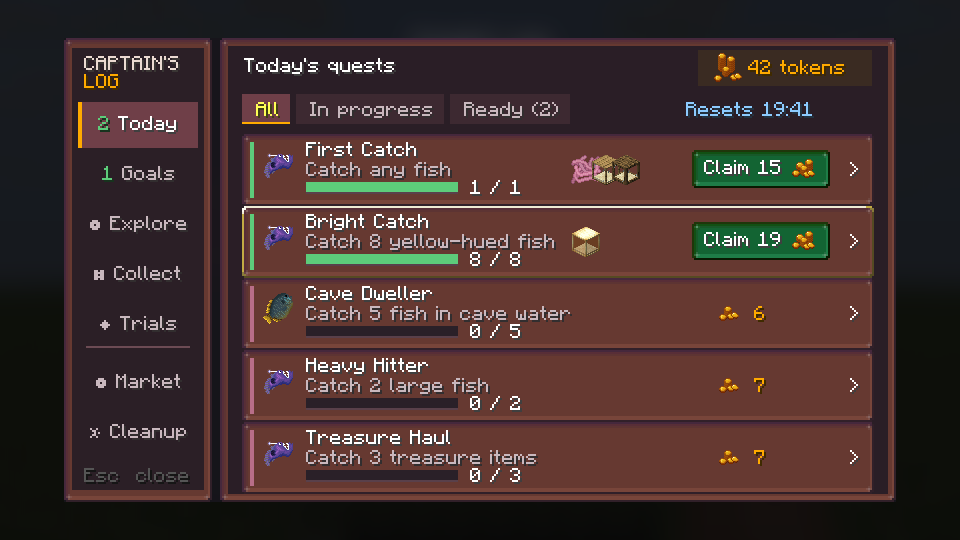
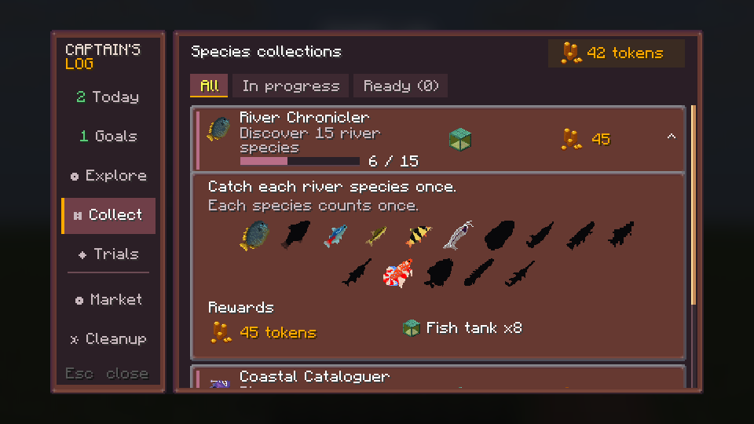
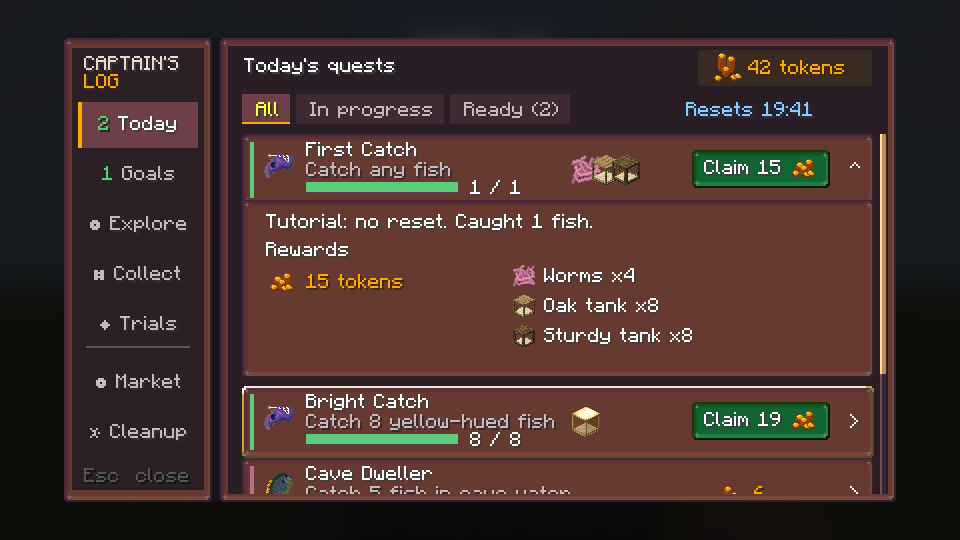
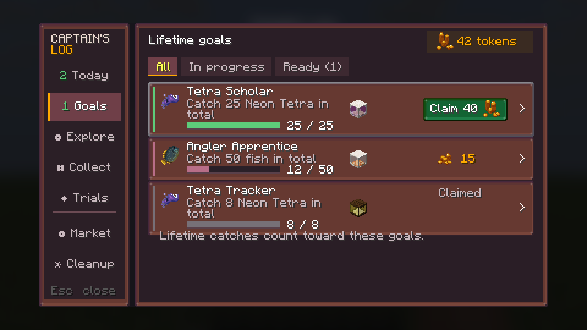
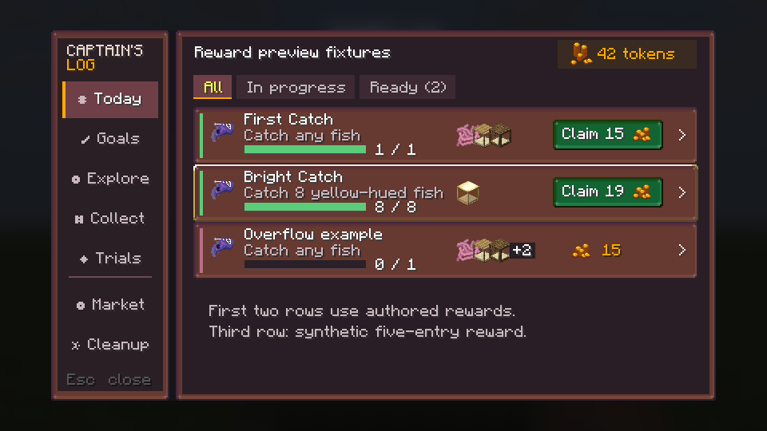
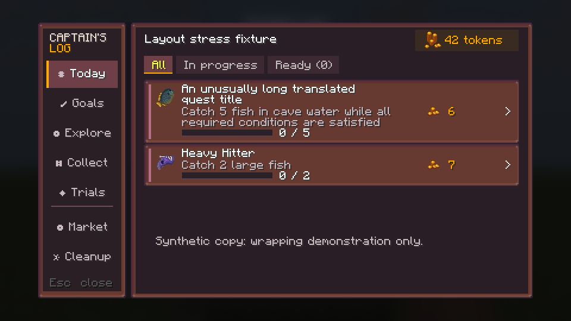
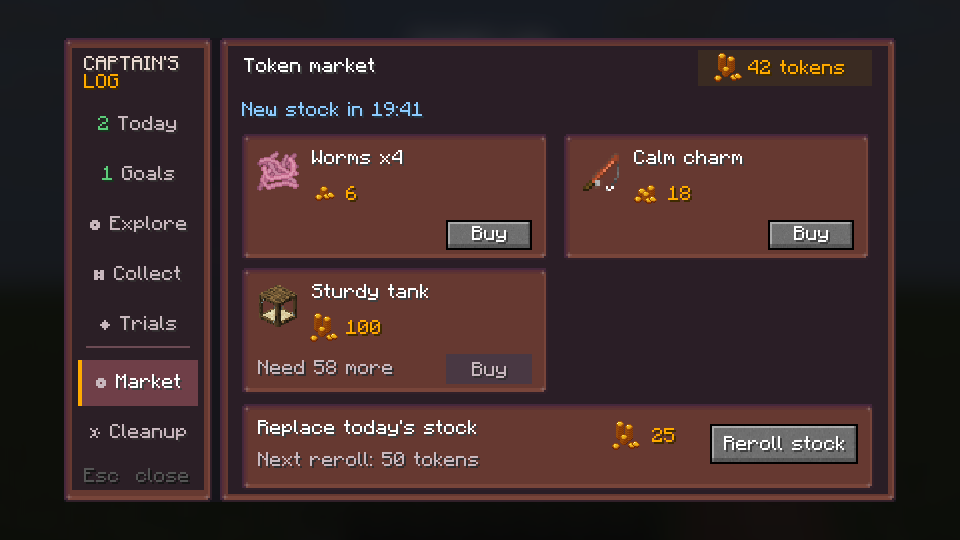
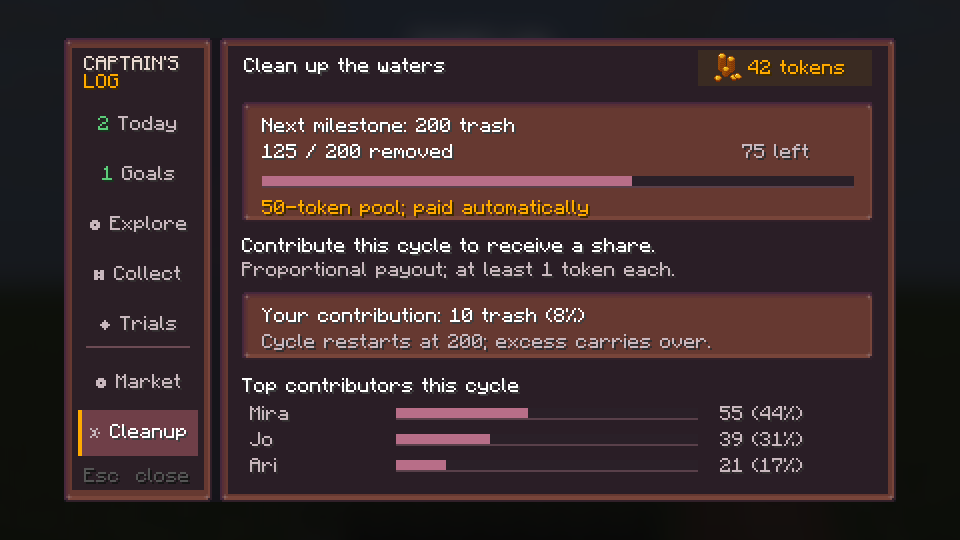

# Quest book redesign

Status: visual redesign implemented and reviewed in-game on 20 October 2026. See the
[implementation review and runtime captures](review/README.md) for corrections, checks and
remaining validation limits. The design discussion below records the original proposal and
its historical baseline.

## Start here

- [Mockup gallery](mockups/index.html)
- [Interaction and visual specification](design-spec.md) — the normative design handoff
- [Current versus proposed, matched content](mockups/compare_current_vs_proposed.png)
- [Current live capture](run-fabric/screenshots/selftest-fabric-fixes-quest_log.png)
- [Mockup entry point](mockups/render_mockups.py)
- [Reviewed screen renderer](mockups/render_card_review.py)

This revision supersedes the first-pass four-card board and the second-pass 23-pixel rows.
The collection is fully visible in its expanded row. The separate View species screen and
its obsolete mockup have been removed.

## Design decision

Keep the Captain's Log shell: labelled navigation, a stable token balance, and a focused
surface using Fishtastic's panels, bitmap font and coin artwork. Use a list of actionable
objectives, with inline Claim and one expanded row for details. Give Market and Cleanup
layouts suited to their different decisions.

The default row is now 36 logical pixels high. Five rows fit the daily fixture; longer
objectives may increase row height. Visibility of seven rows is no longer a design goal.
The player must understand the action, qualifying condition, progress unit and reward
without opening every row. Quest cards retain the first mockups' original warm mauve texture;
no dark ink wash is applied to their backgrounds. Bronze uses the standard panel, while
silver and gold use their shipped tier-specific border sprites, including in expanded details.
These frames communicate difficulty; focus uses a separate outline rather than replacing them.

## Evidence and limits

The baseline is a real Fabric self-test capture at 960×540, logical 480×270, recorded in
`run-fabric/screenshots/selftest-fabric-fixes-quest_log.png`. The proposal uses existing
pixel-font and panel renderers at the same dimensions. It is static concept art, not a
working interaction prototype.

The current screen has seven icon-only destinations, a three-column quest grid, and
world/HUD content behind it. These observations support clearer navigation and a focused
surface. They do not establish that players complete tasks faster with the proposal.

The revised comparison uses the same five quests, counts, tiers, token/item rewards,
zero-ready state, zero-token balance and 19:41 reset as the live capture:

| Quest | Progress | Tokens | Item reward entries |
|---|---:|---:|---:|
| First Catch | 0 / 1 | 15 | 3 |
| Cave Dweller (bronze) | 0 / 5 | 6 | 0 |
| Heavy Hitter (bronze) | 0 / 2 | 7 | 0 |
| Treasure Haul (bronze) | 0 / 3 | 7 | 0 |
| Bright Catch (gold) | 0 / 8 | 19 | 1 |

The tutorial occupies its existing first-run slot in Today. Other entries in Today belong
to the active daily rotation. Lifetime mastery and collections are not mixed into it.
The comparison controls content and state; it is visual evidence, not a measured usability result.

## Changes following expert review

| Review finding | Revised decision |
|---|---|
| Compact summaries lose the action and progress unit | Use verb-led objective text such as “Catch 2 large fish” and “Discover 15 river species”; retain essential conditions and allow wrapping. |
| Ready scope is ambiguous | Ready filters only the current category. Navigation shows each category's unclaimed-ready count. The default fixture has Today 2 and Goals 1. |
| Difficulty should preserve the existing visual language | Use the shipped bronze, silver and gold panel sprites. Remove letter badges. Selection/focus uses a separate high-contrast outline; tier names remain in tooltips and narration. |
| Full green details overwhelm the page | Preserve the original warm mauve panel texture for cards and expanded details, with a narrow green ready strip and the established green Claim button. |
| Expansion repeats information | Collections show every eligible species inline: colored when caught, black silhouette otherwise, matching the existing quest collections. Condition quests explain their actual qualifying rules. |
| Ready rows hide reward inspection | Show up to three overlapping item previews beside Claim; keep disclosure visible and expose all rewards in tooltips and expanded details. |
| Claim/reordering can move targets unexpectedly | Show pending/success in place and defer reordering while the player is interacting; preserve the focused quest and scroll anchor. |
| Track has no defined outcome | Omit Track from this version. No HUD tracking behavior is proposed. |
| Market hides affordability and paid-reroll meaning | Show disabled Buy plus the shortfall; distinguish “New stock in” from paid “Reroll stock” and expose the next price. |
| Cleanup omits payout/eligibility and loses personal context | Explain the existing 200-trash / 50-token cycle, automatic proportional payouts and minimum; pin the player's own contribution above the contributor list. |

## Current mockup set

### Today's quests



Two claimable entries are first. Five readable rows show objective, count, token reward,
actual item previews and separate disclosure. Up to three 16-pixel sprites overlap horizontally
by six pixels in the gap before Claim. Larger reward sets add an omitted-entry badge. The First Catch tutorial is a first-run exception to daily navigation.
The timer applies to daily entries, not the tutorial. Navigation's Goals badge signals a
separate ready reward without adding that quest to Today.

### Expanded collection



Collect remains active. River Chronicler shows all fifteen eligible species in a wrapping
grid: six caught fish use their colored artwork, while nine uncaught fish use their actual
black silhouettes. This restores the current quest collections' visual treatment instead of
“Found: Bluegill…” / “9 undiscovered…” text. No separate species screen or View species button
is needed. Hover/focus identifies caught fish and species icons link directly to the encyclopedia.
Row and list scrolling stay inside the frame.
The same shared Rewards block used by other expanded quests shows the token icon/amount
at left and the authored tank icon, name and quantity at right. Collections have no special
reward-summary layout.

### Expanded reward



First Catch shows 15 tokens, worms x4, oak tanks x8 and sturdy tanks x8, matching the authored
reward, using the same shared Rewards block as collections and all other quest categories.
Its original warm mauve detail surface matches the first mockups. Claim and collapse
remain separate targets. Stack counts and component-sensitive item details must remain
available through tooltips in implementation.

### Lifetime goals



Mastery remains separate from Collect. Tetra Scholar uses its authored 25-catch target,
40 tokens and tank reward. This fixture assumes its prerequisite was satisfied, so showing
it does not propose bypassing hidden-quest visibility rules. The list also demonstrates an
in-progress goal and an explicitly Claimed prerequisite.

### Item stack previews



All item preview groups share a fixed left edge, including overflow cases. Single rewards show one sprite; First Catch shows its three reward entries with a small
horizontal overlap. The synthetic five-entry fixture shows three sprites with a `+2` badge
at the right edge of the last stacked item, overlapping it by two pixels, for the omitted entries. Quantities and component details remain in the full reward list
and hover/focus tooltip instead of being squeezed onto overlapping sprites. The preview and
expanded reward images use real in-game ItemStack captures, including each tank's materials
and shape components. They do not use the tank assembly GUI icon.

### Wrapping stress fixture



Synthetic long title and objective text grow the row without shrinking the font or removing
conditions. The next row starts after that new height. This is a layout fixture, not a new
quest definition or a claim that translations have been tested in-game.

### Market



With 42 tokens, the in-stock 100-token item needs 58 more. Sold-out items are removed
entirely; the remaining panels pack into the grid with no Bought tile or placeholder. A paid reroll costs 25 now and 50 next. The product names and stock prices
are illustrative; this is a UI fixture, not a shop balance or item-registration proposal.

### Cleanup



The sample cycle is 125 / 200, leaving 75. A 50-token pool is paid automatically to cycle
contributors, proportional to contribution, rounded with at least one token each. Rounding
means the pool is the calculation basis, not a guarantee that individual awards sum to 50.
Your 10 trash (8%) stays visible above the other contributors. No fixed personal payout
is promised while the cycle is still in progress.

## Verification and remaining validation

Generate every current screen and both matched comparison sheets with:

```powershell
python -I docs/quest-log-redesign/mockups/render_mockups.py
```

The renderer reads authored quest names, tiers, rewards and count targets. Collection target
counts resolve local tags and exclusions. It checks declared text widths, the baseline fixture
and the ready count. Visual inspection is also required: width checks do not detect every
collision, vertical issue, focus problem or unusable interaction.

The images were rendered and visually inspected after this revision. Keyboard navigation,
post-claim behavior, scroll anchoring, server failures, translation wrapping and smaller
viewports remain prototype/implementation validation tasks. See the acceptance checklist in
[the specification](design-spec.md#acceptance-and-playtest-gate).

Use identical quest data for A/B tasks: find a claimable reward, choose a feasible quest,
and identify what remains in a collection. Compare completion time, wrong-row opens and
objective comprehension. The design hypotheses remain unproven until those tests run.

## Actual item sprite captures

Fish tanks are rendered item models, not flat GUI sprites. The mockups use ten transparent
GUI item captures from Minecraft 26.1.2 Fabric, keyed by item ID and complete component data.
The [manifest](mockups/assets/items/manifest.json) records their authored quests and reward
indices. The [black capture](run-item-export/screenshots/selftest-fabric-questsprites-black.png)
and [white capture](run-item-export/screenshots/selftest-fabric-questsprites-white.png)
provide the two backgrounds used to recover transparency. No count overlays are captured.

To regenerate after changing item appearance:

```powershell
./gradlew.bat -I docs/quest-log-redesign/item-export.init.gradle :fabric:runClient --console=plain
python -I docs/quest-log-redesign/item-export/extract_sprites.py
Remove-Item -LiteralPath docs/quest-log-redesign/run-item-export/fishtastic_render_selftest
Remove-Item -LiteralPath docs/quest-log-redesign/item-export/generated/RenderSelfTest.java
./gradlew.bat :common:compileJava --console=plain
python -I docs/quest-log-redesign/mockups/render_mockups.py
```

The init script compiles a generated export-only copy of the dev harness and uses its own run
directory. Production source is unchanged. The normal compile restores ordinary harness classes
afterward. The marker must be removed after the capture, including failed runs. The recorded
[capture log](item-export/capture.log) passed `questsprites.rewardStacks` with ten stacks;
the [normal compile log](item-export/restore-compile.log) confirms restoration. These captures
validate the displayed item appearances, not the proposed screen's interactions.
